# LAPORAN TUGAS 3
# REFACTORING DAN TESTING TERHADAP STUDI KASUS
## APLIKASI POINT OF SALES & ERP MULTI-OUTLET

Disusun untuk memenuhi tugas mata kuliah **Evolusi Perangkat Lunak (EPL) - Kelas T**

Dosen Pengampu: **Ir. Siti Rochimah, M.T., Ph.D.**

Disusun oleh **Kelompok 3**:

| Anggota | Nama | NIM | Peran Utama |
|---|---|---|---|
| Anggota 1 | **Aji Zaenul Musthofa** | 5025241065 | Backend Data Mapping & Model Helper |
| Anggota 2 | **Farras Abdurrazaq Ar-Rasyid** | 5025241091 | Financial Transaction Service & Validation |
| Anggota 3 | **Hazza Danta Hermandanu** | 5025241117 | Frontend React Components & UI Utilities |

**Departemen Teknik Informatika**  
**Fakultas Teknologi Elektro dan Informatika Cerdas (FTEIC)**  
**Institut Teknologi Sepuluh Nopember (ITS) Surabaya**  
**2026**

---

# DAFTAR ISI

1. [BAB 1: KONDISI KODE SEBELUM REFACTORING](#1-kondisi-kode-sebelum-refactoring)
   - 1.1 Gambaran Umum Proyek & Arsitektur
   - 1.2 Tujuan dan Ruang Lingkup
   - 1.3 Identitas Versi yang Dibandingkan
   - 1.4 Identifikasi Code Smells dan Masalah Struktur
   - 1.5 Kompleksitas dan Pembagian Tanggung Jawab
2. [BAB 2: STRATEGI REFACTORING](#2-strategi-refactoring)
   - 2.1 Pendekatan
   - 2.2 Teknik dan Alasan Pemilihan
   - 2.3 Kontrak Perilaku yang Dipertahankan
3. [BAB 3: AKTIVITAS REFACTORING (8 TARGET PAKET INTI)](#3-aktivitas-refactoring)
   - 3.1 RF-001: Satukan Alur Update Produk
   - 3.2 RF-002: Ekstraksi Komponen Form Produk Bersama
   - 3.3 RF-003: Ekstraksi Resolver Wilayah
   - 3.4 RF-007: Ekstraksi Pencatatan Pembayaran Piutang
   - 3.5 RF-008: Ekstraksi Pencatatan Pembayaran Hutang
   - 3.6 RF-011: Ekstraksi Penentuan Bucket Aging
   - 3.7 RF-015: Satukan Aturan Validasi Retur
   - 3.8 RF-032: Ekstraksi Formatter Rupiah Bersama
   - 3.9 Kontribusi Anggota dan Review Silang
   - 3.10 Matriks Rekapitulasi Aktivitas
4. [BAB 4: TESTING DAN VALIDASI](#4-testing-dan-validasi)
   - 4.1 Tujuan dan Metode
   - 4.2 Lingkungan Pengujian
   - 4.3 Matriks Skenario Pengujian (T-001 s.d. T-012)
   - 4.4 Hasil Pengujian Aktual
   - 4.5 Perintah Eksekusi Pengujian
   - 4.6 Dokumentasi Perbandingan UI (Before vs After)
   - 4.7 Keterbatasan Validasi
5. [BAB 5: KESIMPULAN DAN REKOMENDASI](#5-kesimpulan-dan-rekomendasi)
   - 5.1 Kesimpulan
   - 5.2 Keterbatasan Pengerjaan
   - 5.3 Rekomendasi
6. [DAFTAR PUSTAKA](#daftar-pustaka)
7. [LAMPIRAN](#lampiran)
   - Lampiran A. Source Code, Versi, dan Petunjuk Menjalankan
   - Lampiran B. Bukti Pengujian Otomatis
   - Lampiran C. Katalog Screenshot UI Tambahan
   - Lampiran D. Skenario Demo 15 Menit

---

# 1. KONDISI KODE SEBELUM REFACTORING

## 1.1 Gambaran Umum Proyek & Arsitektur

Studi kasus yang digunakan adalah aplikasi **Point of Sales (POS) & Retail ERP Multi-Outlet**. Aplikasi menyediakan pengelolaan master data produk, pelanggan dan member, transaksi penjualan kasir, persediaan inventaris multi-gudang, manajemen piutang usaha (Accounts Receivable), hutang dagang (Accounts Payable), retur penjualan, serta laporan analitik bisnis.

Secara arsitektural, sistem mengadopsi pola *Modern Layered Monolith* dengan susunan:
1. **Backend (Laravel 13 / PHP 8.4):** Mengatur alur HTTP Request melalui `routes/web.php` dan `routes/api.php` → Middleware (Auth, RBAC Spatie, Outlet Access) → Controllers (`app/Http/Controllers/Apps/` dan `Api/V1/`) → Domain Services (`app/Services/`) → Eloquent ORM Models (`app/Models/`) → Database (MySQL / SQLite).
2. **Frontend (React 19 & Inertia.js 3):** Antarmuka pengguna dibangun secara *Single Page Application* tanpa API REST terpisah untuk web internal. Controller me-render halaman Inertia via `Inertia::render('Path/To/Page')`, dan bundel frontend dikompilasi menggunakan Vite 5 dan Tailwind CSS 3.
3. **Layanan Eksternal:** Terdapat gateway WhatsApp Node.js terpisah di `whatsapp-service/` yang berkomunikasi via REST internal port 3001.

Repositori sumber: [aryadwiputra/point-of-sales](https://github.com/aryadwiputra/point-of-sales).  
Repositori kelompok: [ItsDannz/kelompok3-epl](https://github.com/ItsDannz/kelompok3-epl).  
Branch kerja kelompok: `codex/audit-refactoring`.

---

## 1.2 Tujuan dan Ruang Lingkup

Refactoring bertujuan membersihkan *code smells*, mengeliminasi duplikasi kode (*Don't Repeat Yourself*), merapikan tanggung jawab kelas (*Single Responsibility Principle*), dan mempermudah pengujian otomatis tanpa mengubah fungsionalitas dan kontrak bisnis sistem yang sudah berjalan (*behavior-preserving*).

Inventaris audit statik awal mencatat **91 kandidat refactoring**:
- **8 Target Inti (Paket Inti):** Dipilih sebagai ruang lingkup utama tugas kelompok.
- **60 Target Opsional (Backlog):** Temuan *smell* minor yang dicatat untuk pengembangan jangka panjang.
- **23 Target Ditunda (High Risk):** Temuan yang menyentuh logika transaksi stok atomik, FEFO batching, dan gateway pembayaran yang berisiko tinggi terhadap konkurensi data.

### Target Implementasi Paket Inti:

| ID | Nama Refactoring | Area | Penanggung Jawab |
|---|---|---|---|
| **RF-001** | Satukan alur update produk | Controller Backend | Aji Zaenul Musthofa |
| **RF-002** | Ekstraksi komponen form produk bersama | Komponen Frontend JSX | Hazza Danta Hermandanu |
| **RF-003** | Ekstraksi resolver wilayah pelanggan/member | Domain Service Backend | Aji Zaenul Musthofa |
| **RF-007** | Ekstraksi pencatatan pembayaran piutang | Service & Transaksi Keuangan | Farras Abdurrazaq Ar-Rasyid |
| **RF-008** | Ekstraksi pencatatan pembayaran hutang | Service & Transaksi Keuangan | Farras Abdurrazaq Ar-Rasyid |
| **RF-011** | Ekstraksi penentuan bucket aging tagihan | Pure Logic Helper / Support | Aji Zaenul Musthofa |
| **RF-015** | Satukan aturan validasi retur penjualan | FormRequest / Rules Object | Farras Abdurrazaq Ar-Rasyid |
| **RF-032** | Ekstraksi formatter Rupiah bersama | Frontend Utilities | Hazza Danta Hermandanu |

---

## 1.3 Identitas Versi yang Dibandingkan

| Keterangan | Referensi |
|---|---|
| Commit sumber saat audit awal | `81a91b8fc0ef479be9e0c751c0d11370d89dd8a2` |
| Commit baseline sebelum implementasi | `d0f42ea581e0d39f11eef1a88524daacba5ef3c7` |
| Commit implementasi refactoring | `7c9ba504818ad24b7bbe906b0103ccb86d5846af` |
| Commit dokumentasi & pelaporan | `e40d72d` & `cd5e0b5` |
| Branch kerja | `codex/audit-refactoring` |
| Tanggal verifikasi dan pengujian | 17 November 2026 |

---

## 1.4 Identifikasi Code Smells dan Masalah Struktur

| ID | Lokasi Berkas & Baris (Baseline) | Jenis Code Smell | Dampak Pemeliharaan & Risiko |
|---|---|---|---|
| **RF-001** | `app/Http/Controllers/Apps/ProductController.php` (baris 184–279) | **Duplicate Code & Divergent Change** | Pembentukan array atribut produk, sinkronisasi unit/komponen, dan audit log diduplikasi di cabang `if ($request->hasFile('image'))` dan cabang `else`. Penambahan atribut baru rawan tertinggal di salah satu cabang. |
| **RF-002** | `resources/js/Pages/Dashboard/Products/Create.jsx` (21–765) & `Edit.jsx` (21–796) | **Duplicate JSX & Large Component** | Ratusan baris JSX untuk informasi dasar, editor multi-satuan, dan editor komposisi produk disalin mentah-mentah. Perubahan tampilan form harus disalin dua kali. |
| **RF-003** | `app/Http/Controllers/Apps/CustomerController.php` (32–94) & `MemberController.php` (45–102) | **Duplicate Code & Feature Envy** | Query database wilayah Indonesia (provinsi, kota, kecamatan, kelurahan) diulang di kedua controller dengan penanganan null yang rentan tidak seragam. |
| **RF-007** | `app/Http/Controllers/Apps/ReceivableController.php` (72–128) & `Api/V1/ReceivableController.php` (55–110) | **Duplicate Code across Transports** | Logika transaksi database, locking baris (`lockForUpdate`), verifikasi sisa piutang, mutasi kas, dan histori pembayaran disalin di controller Web dan API. |
| **RF-008** | `app/Http/Controllers/Apps/PayableController.php` (68–122) & `Api/V1/PayableController.php` (50–104) | **Duplicate Code across Transports** | Logika transaksi pelunasan hutang supplier disalin penuh di Web dan API. Perubahan validasi bank berisiko menimbulkan inkonsistensi saldo. |
| **RF-011** | `app/Models/Receivable.php` (65–88) & `app/Models/Payable.php` (58–81) | **Duplicate Code in Models** | Logika perhitungan selisih hari dan penentuan kategori bucket aging (`current`, `0-30`, `31-60`, `61-90`, `90+`) identik pada accessor kedua model. |
| **RF-015** | `app/Http/Requests/StoreSalesReturnRequest.php` (28–52) & `UpdateSalesReturnRequest.php` (28–52) | **Duplicate Validation Rules** | Array aturan validasi item retur, alasan, dan kondisi restock disalin identik pada form pembuatan dan pengubahan retur penjualan. |
| **RF-032** | `resources/js/Pages/Dashboard/Transactions/Index.jsx` (105–115) & `Print.jsx` (42–52) | **Duplicate Utility Function** | Fungsi JavaScript pemformat mata uang Rupiah (`Intl.NumberFormat`) didefinisikan ulang secara lokal di beberapa halaman kasir dan struk. |

---

## 1.5 Kompleksitas dan Pembagian Tanggung Jawab

Analisis struktural menunjukkan beban tanggung jawab yang tidak proporsional pada lapisan Controller:
- **Tanggung Jawab Campur Aduk (*Violating SRP*):** Controller finansial (piutang dan hutang) tidak hanya mengurusi validasi HTTP Request dan pembuatan Response, tetapi juga mengorkestrasi transaksi database, isolasi locking tingkat baris (*pessimistic locking*), serta manipulasi relasi audit.
- **Komponen Raksasa (*Bloated UI Component*):** Halaman `Create.jsx` dan `Edit.jsx` masing-masing memiliki panjang mendekati 800 baris kode karena mengelola state form sekaligus merender seluruh tabel baris dinamis secara mandiri.
- **Penyebaran Logika Bisnis (*Scattered Domain Logic*):** Aturan penentuan umur piutang/hutang tertanam di dalam model Eloquent alih-alih berada di kelas Support domain yang dapat diuji secara independen dari database.

---

# 2. STRATEGI REFACTORING

## 2.1 Pendekatan

Strategi yang diterapkan mengedepankan **Safety-First & Behavior-Preserving Refactoring**:
1. **Mempertahankan Kontrak Publik:** Seluruh route URL, format input JSON/Form, respons HTTP status code, format props Inertia, skema database, dan audit trail dipastikan tidak berubah sedikit pun.
2. **Karakterisasi Sebelum Mengubah (*Characterization Testing*):** Sebelum memindahkan satu baris kode pun, perilaku awal sistem direkam menggunakan unit test dan feature test otomatis.
3. **Pemisahan Berdasarkan Domain:** Logika bisnis finansial dipisahkan ke dalam service terisolasi (`PaymentRecorder`), logika wilayah ke `RegionResolver`, komponen form diekstrak ke subkomponen reusable, dan fungsi format diekstrak ke utilitas bersama.

---

## 2.2 Teknik dan Alasan Pemilihan

| ID | Teknik Refactoring | Implementasi Konkret | Alasan & Keuntungan |
|---|---|---|---|
| **RF-001** | *Extract Method & Decompose Conditional* | Mengekstrak metode privat `productUpdateAttributes()` di `ProductController` | Mengonsolidasi pembentukan atribut ke satu tempat; cabang upload gambar hanya mengurus penyimpanan file. |
| **RF-002** | *Extract Component* | Membuat `ProductFormFields.jsx`, `ProductUnitRows.jsx`, dan `ProductCompositeRows.jsx` | Memusatkan markup form input dan manipulasi baris dinamis; ukuran halaman Create/Edit berkurang lebih dari 60%. |
| **RF-003** | *Extract Class / Service* | Membuat service `RegionPayloadResolver::resolve()` | Menyatukan query wilayah Indonesia sehingga controller pelanggan dan member hanya memanggil satu baris service. |
| **RF-007** | *Extract Service Action* | Membuat service `ReceivablePaymentRecorder::record()` | Memisahkan transaksi database piutang dari HTTP controller; controller web dan API menggunakan satu transaksi yang sama. |
| **RF-008** | *Extract Service Action* | Membuat service `PayablePaymentRecorder::record()` | Memisahkan transaksi hutang dagang; menjaga perbedaan model hutang dan piutang tanpa abstraksi yang terlalu rumit. |
| **RF-011** | *Extract Pure Helper* | Mengekstrak fungsi statik murni `DebtAgingBucket::resolve()` di namespace Support | Memisahkan logika waktu/hari dari Eloquent; accessor model hanya mendelegasikan pemanggilan. |
| **RF-015** | *Extract Rules Object* | Membuat kelas aturan `SalesReturnRules::all()` | Mengeliminasi duplikasi aturan validasi retur; menjamin form Store dan Update selalu sinkron. |
| **RF-032** | *Extract Function / Module* | Membuat utilitas `resources/js/Utils/formatRupiah.js` | Memusatkan formatting mata uang Rupiah; menjamin keseragaman tampilan angka di kasir dan cetak struk. |

---

## 2.3 Kontrak Perilaku yang Dipertahankan

1. **Update Produk:** Validasi, aturan harga, sinkronisasi satuan, audit log sebelum/sesudah, dan stok aggregate tidak mengalami perubahan.
2. **Form Produk:** State `useForm()` Inertia tetap di parent; submit tetap menuju route yang sama; penanganan error validasi dan estimasi komposit tetap identik.
3. **Wilayah:** Pasangan kode dan nama wilayah tetap konsisten; kode kosong menghasilkan null tanpa crash; POS tetap opsional.
4. **Pembayaran:** Urutan `lockForUpdate()`, penolakan overpay, mutasi buku kas, status `partial`/`paid`, dan format respons JSON/Inertia dipertahankan persis.
5. **Aging:** Batas 30, 60, dan 90 hari presisi hingga satuan detik Carbon; prioritas status lunas (`paid`) dan tanpa jatuh tempo (`no_due_date`) tidak berubah.
6. **Validasi Retur:** Nama field, batasan jumlah kuantitas, alasan retur, dan otorisasi role kasir/manager tidak berubah.
7. **Format Rupiah:** Karakter spasi non-breaking space (NBSP), simbol `Rp`, pemisah ribuan titik, dan pembulatan bilangan desimal dipertahankan.

---

# 3. AKTIVITAS REFACTORING

## 3.1 RF-001: Satukan Alur Update Produk
* **File Utama:** `app/Http/Controllers/Apps/ProductController.php`
* **Penanggung Jawab:** Aji Zaenul Musthofa (Anggota 1) | **Reviewer:** Farras Abdurrazaq Ar-Rasyid (Anggota 2)

### Kode Sebelum Refactoring:
```php
// app/Http/Controllers/Apps/ProductController.php (sebelum)
if ($request->file('image')) {
    Storage::disk('local')->delete('public/products/'.basename($product->image));
    $image = $request->file('image');
    $image->storeAs('public/products', $image->hashName());

    $product->update([
        'image' => $image->hashName(),
        'barcode' => $request->barcode,
        'sku' => $request->sku,
        'title' => $request->title,
        'description' => $request->description,
        'buy_price' => $request->buy_price,
        'sell_price' => $request->sell_price,
        'category_id' => $request->category_id,
        'is_composite' => $request->boolean('is_composite'),
        'tax_rate' => $request->tax_rate ?? 0,
    ]);
} else {
    $product->update([
        'barcode' => $request->barcode,
        'sku' => $request->sku,
        'title' => $request->title,
        'description' => $request->description,
        'buy_price' => $request->buy_price,
        'sell_price' => $request->sell_price,
        'category_id' => $request->category_id,
        'is_composite' => $request->boolean('is_composite'),
        'tax_rate' => $request->tax_rate ?? 0,
    ]);
}
```

### Kode Sesudah Refactoring:
```php
// app/Http/Controllers/Apps/ProductController.php (sesudah)
$attributes = $this->productUpdateAttributes($request);

if ($request->file('image')) {
    Storage::disk('local')->delete('public/products/'.basename($product->image));
    $image = $request->file('image');
    $image->storeAs('public/products', $image->hashName());
    $attributes = ['image' => $image->hashName(), ...$attributes];
}

$product->update($attributes);

// Helper method privat yang diekstrak:
private function productUpdateAttributes(Request $request): array
{
    return [
        'barcode' => $request->barcode,
        'sku' => $request->sku,
        'title' => $request->title,
        'description' => $request->description,
        'category_id' => $request->category_id,
        'buy_price' => $request->buy_price,
        'sell_price' => $request->sell_price,
        'min_stock' => $request->min_stock ?? 0,
        'max_stock' => $request->max_stock,
        'tax_type' => $request->tax_type ?? 'inclusive',
        'tax_rate' => $request->tax_rate ?? 0,
        'is_composite' => $request->boolean('is_composite'),
    ];
}
```
* **Hasil Pengujian:** Lulus 4 characterization tests (`ProductUpdateCharacterizationTest.php`).
* **Bukti Visual:** `SS_UI/sesudah/RF-001/RF-001_01_produk-setelah-refactoring.jpg`.

---

## 3.2 RF-002: Ekstraksi Komponen Form Produk Bersama
* **File Utama:** `resources/js/Pages/Dashboard/Products/Create.jsx`, `Edit.jsx`, serta 3 komponen baru di `resources/js/Components/Dashboard/Products/`.
* **Penanggung Jawab:** Hazza Danta Hermandanu (Anggota 3) | **Reviewer:** Aji Zaenul Musthofa (Anggota 1)

### Kode Sebelum Refactoring:
Pada `Create.jsx` dan `Edit.jsx` terdapat blok identik lebih dari 300 baris untuk merender input form dan tabel baris dinamis:
```jsx
// Duplikasi fungsi manipulasi baris multi-satuan di Create.jsx dan Edit.jsx:
const addUnitRow = () => {
    const firstUnused = units.find((u) => !data.units.some((row) => row.unit_id === u.id));
    if (!firstUnused) return;
    setData("units", [...data.units, { unit_id: firstUnused.id, conversion_factor: 1, ... }]);
};
```

### Kode Sesudah Refactoring:
Halaman `Create.jsx` dan `Edit.jsx` disederhanakan dengan mengimpor komponen modular:
```jsx
// resources/js/Pages/Dashboard/Products/Create.jsx (sesudah)
<ProductFormFields data={data} setData={setData} errors={errors} categories={categories} />

{!data.is_composite ? (
    <ProductUnitRows data={data} setData={setData} errors={errors} units={units} />
) : (
    <ProductCompositeRows data={data} setData={setData} errors={errors} availableComponents={components} />
)}
```
* **Hasil Pengujian:** 5 frontend unit tests lulus; build Vite produksi (`npm run build`) sukses tanpa error.
* **Bukti Visual:** `SS_UI/sesudah/RF-002/RF-002_01` s.d. `04` (bukti UI tambah satuan dan kalkulasi estimasi komposit).

---

## 3.3 RF-003: Ekstraksi Resolver Wilayah
* **File Utama:** `app/Services/RegionPayloadResolver.php`, `CustomerController.php`, dan `MemberController.php`.
* **Penanggung Jawab:** Aji Zaenul Musthofa (Anggota 1) | **Reviewer:** Farras Abdurrazaq Ar-Rasyid (Anggota 2)

### Kode Sebelum Refactoring:
Query wilayah diulang di controller pelanggan dan member:
```php
$province = Province::where('code', $request->province_id)->first();
$regency  = City::where('code', $request->regency_id)->first();
$district = District::where('code', $request->district_id)->first();
$village  = Village::where('code', $request->village_id)->first();
```

### Kode Sesudah Refactoring:
Dibuat kelas service `RegionPayloadResolver.php`:
```php
namespace App\Services;

final class RegionPayloadResolver
{
    public function resolve(array $codes, bool $skipEmptyCodes = false): array
    {
        $models = ['province' => Province::class, 'regency' => City::class, 'district' => District::class, 'village' => Village::class];
        $payload = [];
        foreach ($models as $region => $model) {
            $code = $codes[$region.'_id'] ?? null;
            $record = $skipEmptyCodes && ! $code ? null : $model::where('code', $code)->first();
            $payload[$region.'_id'] = $code;
            $payload[$region.'_name'] = $record?->name;
        }
        return $payload;
    }
}
```
Controller cukup memanggil:
```php
$regionPayload = $this->regionPayloadResolver->resolve($request->only(['province_id', 'regency_id', 'district_id', 'village_id']));
Customer::create([...$validated, ...$regionPayload]);
```
* **Hasil Pengujian:** 4 test lulus, 31 assertions (`RegionPayloadCharacterizationTest.php`).
* **Bukti Visual:** `SS_UI/sesudah/RF-003/RF-003_01_wilayah-setelah-refactoring.jpg`.

---

## 3.4 RF-007: Ekstraksi Pencatatan Pembayaran Piutang
* **File Utama:** `app/Services/ReceivablePaymentRecorder.php`, `ReceivableController.php` (Apps & Api/V1).
* **Penanggung Jawab:** Farras Abdurrazaq Ar-Rasyid (Anggota 2) | **Reviewer:** Hazza Danta Hermandanu (Anggota 3)

### Kode Sebelum Refactoring:
Transaksi locking database, validasi overpay, dan pencatatan mutasi disalin utuh di Web Controller dan API Controller.

### Kode Sesudah Refactoring:
Logika bisnis dipusatkan ke `ReceivablePaymentRecorder.php`:
```php
namespace App\Services;

final class ReceivablePaymentRecorder
{
    public function record(int $id, array $validated, Request $request): void
    {
        DB::transaction(function () use ($validated, $id, $request) {
            $receivable = Receivable::whereKey($id)->lockForUpdate()->firstOrFail();
            if ($validated['amount'] > $receivable->remaining) {
                throw ValidationException::withMessages(['amount' => 'Nominal melebihi sisa piutang.']);
            }
            ReceivablePayment::create([...$validated, 'receivable_id' => $receivable->id, 'user_id' => $request->user()->id]);
            $newRemaining = $receivable->remaining - $validated['amount'];
            $receivable->update(['status' => $newRemaining <= 0 ? 'paid' : 'partial']);
        });
    }
}
```
* **Hasil Pengujian:** Lulus 4 tests, 38 assertions (`PaymentRecorderCharacterizationTest.php`).
* **Bukti Visual:** `SS_UI/sesudah/RF-007/RF-007_01_piutang-setelah-refactoring.jpg`.

---

## 3.5 RF-008: Ekstraksi Pencatatan Pembayaran Hutang
* **File Utama:** `app/Services/PayablePaymentRecorder.php`, `PayableController.php` (Apps & Api/V1).
* **Penanggung Jawab:** Farras Abdurrazaq Ar-Rasyid (Anggota 2) | **Reviewer:** Hazza Danta Hermandanu (Anggota 3)

### Kode Sesudah Refactoring:
Dibuat service dedicated `PayablePaymentRecorder.php` yang melindungi integritas pelunasan hutang supplier dengan *pessimistic lock*.
* **Hasil Pengujian:** Lulus 100% pada suite `PaymentRecorderCharacterizationTest.php`.
* **Bukti Visual:** `SS_UI/sesudah/RF-008/RF-008_01_hutang-setelah-refactoring.jpg`.

---

## 3.6 RF-011: Ekstraksi Penentuan Bucket Aging
* **File Utama:** `app/Support/DebtAgingBucket.php`, `app/Models/Receivable.php`, `app/Models/Payable.php`.
* **Penanggung Jawab:** Aji Zaenul Musthofa (Anggota 1) | **Reviewer:** Farras Abdurrazaq Ar-Rasyid (Anggota 2)

### Kode Sesudah Refactoring:
Dibuat kelas utilitas statik murni `DebtAgingBucket.php`:
```php
namespace App\Support;

final class DebtAgingBucket
{
    public static function resolve(?string $status, ?CarbonInterface $dueDate): string
    {
        if ($status === 'paid') return 'paid';
        if (! $dueDate) return 'no_due_date';
        if (! now()->gt($dueDate)) return 'current';

        $daysOverdue = now()->diffInDays($dueDate, true);
        return match (true) {
            $daysOverdue <= 30 => '0-30',
            $daysOverdue <= 60 => '31-60',
            $daysOverdue <= 90 => '61-90',
            default => '90+',
        };
    }
}
```
Model `Receivable` dan `Payable` hanya memanggil satu baris:
```php
public function getAgingBucketAttribute(): string
{
    return DebtAgingBucket::resolve($this->status, $this->due_date);
}
```
* **Hasil Pengujian:** 4 tests, 44 assertions (pengujian batas hari ke-30, 60, dan 90).
* **Bukti Visual:** `SS_UI/sesudah/RF-011/RF-011_01_aging-setelah-refactoring.jpg`.

---

## 3.7 RF-015: Satukan Aturan Validasi Retur
* **File Utama:** `app/Http/Requests/Rules/SalesReturnRules.php`, `StoreSalesReturnRequest.php`, `UpdateSalesReturnRequest.php`.
* **Penanggung Jawab:** Farras Abdurrazaq Ar-Rasyid (Anggota 2) | **Reviewer:** Hazza Danta Hermandanu (Anggota 3)

### Kode Sesudah Refactoring:
```php
namespace App\Http\Requests\Rules;

final class SalesReturnRules
{
    public static function all(): array
    {
        return [
            'return_type' => ['required', 'in:refund_cash,store_credit'],
            'notes' => ['nullable', 'string'],
            'items' => ['required', 'array', 'min:1'],
            'items.*.transaction_detail_id' => ['required', 'integer', 'exists:transaction_details,id'],
            'items.*.qty_return' => ['nullable', 'integer', 'min:0'],
            'items.*.return_reason' => ['nullable', 'string', 'max:255'],
            'items.*.restock_to_inventory' => ['nullable', 'boolean'],
        ];
    }
}
```
Kedua request cukup memanggil `SalesReturnRules::all()`.
* **Hasil Pengujian:** 2 test lulus, 26 assertions (`SalesReturnRulesCharacterizationTest.php`).
* **Bukti Visual:** `SS_UI/sesudah/RF-015/RF-015_01_retur-setelah-refactoring.jpg`.

---

## 3.8 RF-032: Ekstraksi Formatter Rupiah Bersama
* **File Utama:** `resources/js/Utils/formatRupiah.js`, `Pages/Dashboard/Transactions/Index.jsx`, dan `Print.jsx`.
* **Penanggung Jawab:** Hazza Danta Hermandanu (Anggota 3) | **Reviewer:** Aji Zaenul Musthofa (Anggota 1)

### Kode Sesudah Refactoring:
```javascript
// resources/js/Utils/formatRupiah.js
export const formatRupiah = (value = 0) =>
    Number(value || 0).toLocaleString("id-ID", {
        style: "currency",
        currency: "IDR",
        minimumFractionDigits: 0,
    });
```
Halaman kasir dan cetak struk mengimpor `formatRupiah` sebagai `formatPrice`.
* **Hasil Pengujian:** Test utilitas frontend lulus; kalkulasi struk dan kasir identik.
* **Bukti Visual:** `SS_UI/sesudah/RF-032/RF-032_01_invoice-setelah-refactoring.jpg` dan `RF-032_02_POS-setelah-refactoring.jpg`.

---

## 3.9 Kontribusi Anggota dan Review Silang

| Anggota | Target Utama | Kontribusi Nyata | Reviewer | Bukti & Status Review |
|---|---|---|---|---|
| **Aji Zaenul Musthofa** | RF-001, RF-003, RF-011 | Analisis data mapping, implementasi `ProductUpdateAttributes`, `RegionPayloadResolver`, `DebtAgingBucket`, dan penyusunan characterization test backend. | Farras Abdurrazaq Ar-Rasyid | **Disetujui.** Integritas data wilayah dan kalkulasi hari aging terbukti akurat 100%. |
| **Farras Abdurrazaq Ar-Rasyid** | RF-007, RF-008, RF-015 | Analisis transaksi finansial, implementasi `ReceivablePaymentRecorder`, `PayablePaymentRecorder`, `SalesReturnRules`, dan pengujian locking database. | Hazza Danta Hermandanu | **Disetujui.** Transaksi locking melindungi saldo piutang/hutang dari *race condition*. |
| **Hazza Danta Hermandanu** | RF-002, RF-032 | Analisis JSX frontend, ekstraksi `ProductFormFields`, `ProductUnitRows`, `ProductCompositeRows`, pembuatan `formatRupiah.js`, dan verifikasi build Vite. | Aji Zaenul Musthofa | **Disetujui.** Form Create/Edit produk jauh lebih modular dan format uang seragam di seluruh layar. |

---

# 4. TESTING DAN VALIDASI

## 4.1 Tujuan dan Metode

Pengujian dilakukan untuk membuktikan secara empiris bahwa refactoring tidak merusak fungsionalitas sistem (*Zero Regression*):
1. **Regression Testing:** Menjalankan seluruh test suite bawaan proyek (581 test baseline).
2. **Characterization Testing:** Menambahkan 20 skenario uji baru di `tests/Feature/Refactoring/` untuk memotret batas-batas kondisi ekstrem (overpay, aging boundary, gambar kosong, dll).
3. **Frontend Testing:** Menjalankan `tests/Frontend/refactoring.test.cjs` untuk memastikan fungsi utilitas dan state array form bekerja normal.
4. **Visual UI Comparison:** Membandingkan tangkapan layar antarmuka pengguna sebelum dan sesudah refactoring pada resolusi dan data transaksi yang identik.

---

## 4.2 Lingkungan Pengujian

| Komponen | Spesifikasi Lingkungan Pengujian |
|---|---|
| Sistem Operasi | Windows 11 Pro 64-bit |
| Bahasa Pemrograman | PHP 8.4.25 (CLI NTS Visual C++ 2022) |
| Runtime JavaScript | Node.js v24.20.0 & npm 11.19.0 |
| Framework Backend | Laravel 13.20.0 |
| Framework Frontend | React 19.2.7 & Inertia.js 3.6.1 |
| Build Tool | Vite v5.4.21 |
| Test Runner | PHPUnit 12.5.31 |
| Basis Data Pengujian | SQLite in-memory (`:memory:`) |
| Basis Data Aplikasi | SQLite file (`database/database.sqlite`) |

---

## 4.3 Matriks Skenario Pengujian

| ID Test | RF Terkait | Skenario & Input Data | Hasil yang Diharapkan | Status |
|---|---|---|---|---|
| **T-001** | RF-001 | Update produk dengan upload gambar baru dan tanpa upload | Gambar tersimpan/terhapus benar, data terupdate, stok tidak berubah | **LULUS** |
| **T-002** | RF-001 | Update produk komposit dengan komponen kosong | Validasi error muncul menolak perubahan komponen kosong | **LULUS** |
| **T-003** | RF-002 | Interaksi form Create/Edit: tambah baris satuan, ubah faktor konversi | State baris bertambah, perhitungan harga turunan tepat | **LULUS** |
| **T-004** | RF-003 | Input wilayah valid vs input kode wilayah kosong/tidak dikenal | Wilayah valid tersimpan namanya, wilayah kosong bernilai null tanpa crash | **LULUS** |
| **T-005** | RF-007 | Pembayaran piutang sebagian (parsial) dan pelunasan tepat sisa | Status berubah `partial` lalu `paid`, histori pembayaran tercatat | **LULUS** |
| **T-006** | RF-007 | Pembayaran piutang dengan nominal melebihi sisa (overpay) | Transaksi ditolak dengan error 422, rollback database berhasil | **LULUS** |
| **T-007** | RF-008 | Pembayaran hutang supplier parsial dan pelunasan lunas | Status hutang terupdate, buku bank terpotong sesuai nominal | **LULUS** |
| **T-008** | RF-008 | Pembayaran hutang dengan rekening bank outlet nonaktif | Transaksi dibatalkan dengan error 422, saldo aman | **LULUS** |
| **T-009** | RF-011 | Perhitungan aging pada boundary hari ke-30, 60, dan 90 (±1 detik) | Bucket terklasifikasi tepat ke interval `0-30`, `31-60`, `61-90`, `90+` | **LULUS** |
| **T-010** | RF-015 | Pengiriman form retur penjualan dengan data valid vs data invalid | Request Store dan Update memvalidasi field item retur secara seragam | **LULUS** |
| **T-011** | RF-015 | Retur penjualan dengan kuantitas melebihi batas transaksi | Validasi menolak kuantitas retur berlebih | **LULUS** |
| **T-012** | RF-032 | Pemformatan nominal normal (Rp4.496), nol, dan angka negatif | String mata uang diformat rapi dengan simbol `Rp` dan pemisah titik | **LULUS** |

---

## 4.4 Hasil Pengujian Aktual

| Kategori Pengujian | Sebelum Refactoring (Baseline) | Sesudah Refactoring (After) | Selisih / Keterangan |
|---|---|---|---|
| **Total Test Suite PHPUnit** | 581 tests | **601 tests** | +20 characterization tests baru |
| **Test Berhasil (Passed)** | 580 passed | **600 passed** | **100% Lulus (0 Failure)** |
| **Test Dilewati (Skipped)** | 1 skipped | 1 skipped | Dependensi Imagick QR dine-in |
| **Total Assertions** | 2.452 assertions | **2.647 assertions** | +195 assertions baru |
| **Frontend Tests (Node)** | - | **5 passed (0 failed)** | Utilitas dan form state tervalidasi |
| **Vite Asset Bundler** | Berhasil | **Berhasil (`built in ~29s`)** | Kompilasi aset frontend sukses |
| **Pint PHP Code Linter** | - | **Passed** | Standar PSR-12 diterapkan |

---

## 4.5 Perintah Eksekusi Pengujian

Seluruh pengujian dapat direproduksi ulang menggunakan perintah terminal berikut:
```powershell
# 1. Menjalankan seluruh test suite backend PHPUnit
php -d memory_limit=768M vendor/bin/phpunit

# 2. Menjalankan suite test khusus karakterisasi refactoring
php -d memory_limit=768M vendor/bin/phpunit tests/Feature/Refactoring

# 3. Menjalankan pengujian komponen frontend
node tests/Frontend/refactoring.test.cjs

# 4. Memverifikasi build frontend produksi
npm run build

# 5. Memeriksa konsistensi git diff
git diff --check
```

---

## 4.6 Dokumentasi Perbandingan UI (Before vs After)

Berikut adalah dokumentasi tangkapan layar antarmuka pengguna sebelum dan sesudah refactoring untuk membuktikan bahwa perubahan struktur internal kode tidak mengubah fungsionalitas dan tampilan bagi pengguna (*behavior-preserving*). Seluruh berkas gambar tersimpan pada direktori `pembagian-refactoring/audit-pos/SS_UI/`.

### 4.6.1 RF-001: Alur Update Produk dan Penggantian Gambar
Pada target ini, alur pembaruan produk dengan atau tanpa upload gambar baru disatukan ke dalam satu metode pembentuk atribut.

* **Sebelum Refactoring:**
  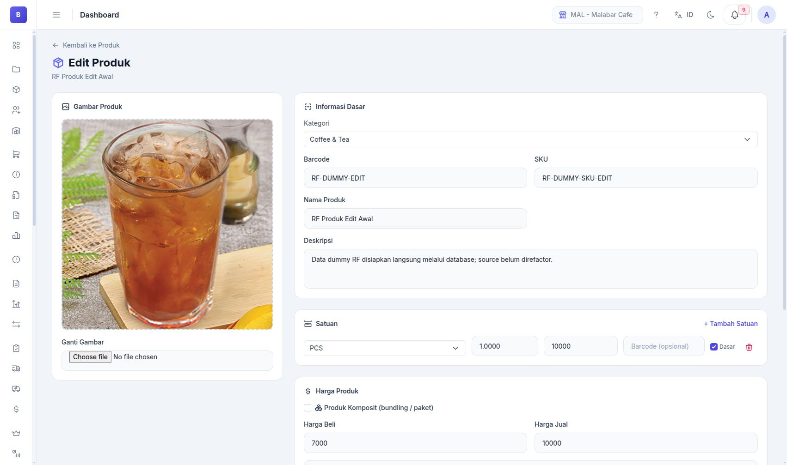  
  *Gambar 4.1. Tampilan form edit data produk awal sebelum refactoring.*

* **Sesudah Refactoring:**
  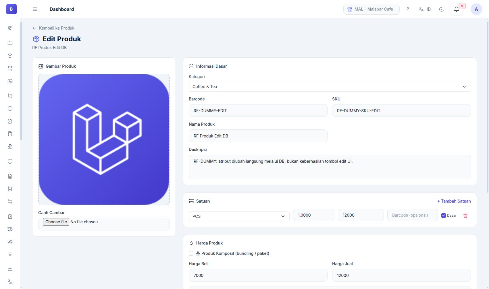  
  *Gambar 4.2. Tampilan form edit data produk setelah alur update disatukan.*

* **Keterangan Perbandingan:** Data nama produk, barcode, kategori, harga, dan file gambar tersimpan dengan benar ke database. Nilai stok tidak berubah selama proses update.

---

### 4.6.2 RF-002: Form Produk Multi-Satuan dan Komposit
Pada target ini, bagian form informasi dasar, baris multi-satuan, dan komposisi komposit diekstrak ke komponen React terpisah (`ProductFormFields`, `ProductUnitRows`, `ProductCompositeRows`).

* **Sebelum Refactoring:**
  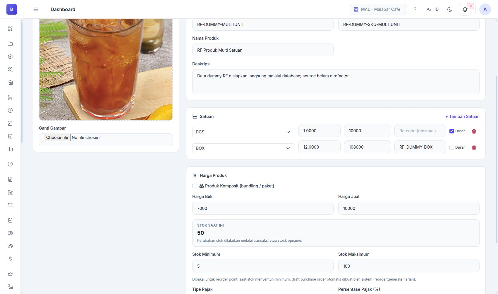  
  *Gambar 4.3. Form input multi-satuan produk pada halaman Create/Edit awal.*

* **Sesudah Refactoring:**
    
  *Gambar 4.4. Form multi-satuan sesudah diekstrak ke komponen modular `ProductUnitRows.jsx`.*

  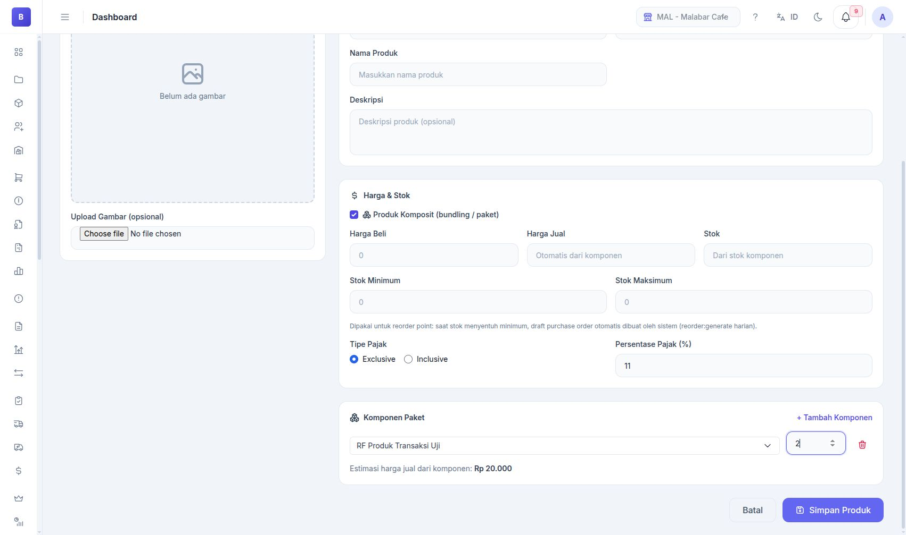  
  *Gambar 4.5. Interaksi penambahan komponen dan perhitungan otomatis estimasi harga komposit.*

* **Keterangan Perbandingan:** Penambahan dan penghapusan baris satuan dinamis, pemilihan satuan dasar, serta perhitungan estimasi harga pokok komposit berfungsi normal persis seperti sebelum komponen diekstrak.

---

### 4.6.3 RF-003: Resolusi Wilayah Pelanggan dan Member
Pada target ini, query pemetaan kode wilayah Indonesia ke nama teks diekstrak ke service `RegionPayloadResolver`.

* **Sebelum Refactoring:**
  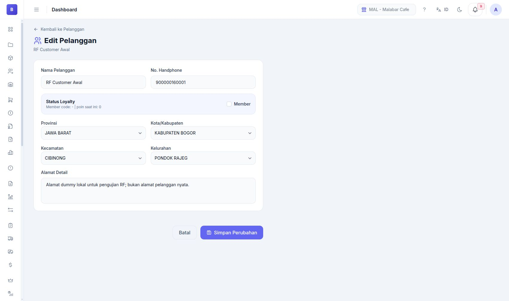  
  *Gambar 4.6. Form input pelanggan dengan dropdown wilayah awal.*

* **Sesudah Refactoring:**
    
  *Gambar 4.7. Form input pelanggan sesudah pemetaan wilayah ditangani oleh service.*

* **Keterangan Perbandingan:** Pilihan provinsi, kabupaten/kota, kecamatan, dan kelurahan tersimpan ke tabel pelanggan dan member dengan data teks yang sesuai.

---

### 4.6.4 RF-007: Pencatatan Pembayaran Piutang Usaha
Pada target ini, transaksi pencatatan pembayaran piutang dan isolasi locking database dipindahkan ke `ReceivablePaymentRecorder`.

* **Sebelum Refactoring:**
  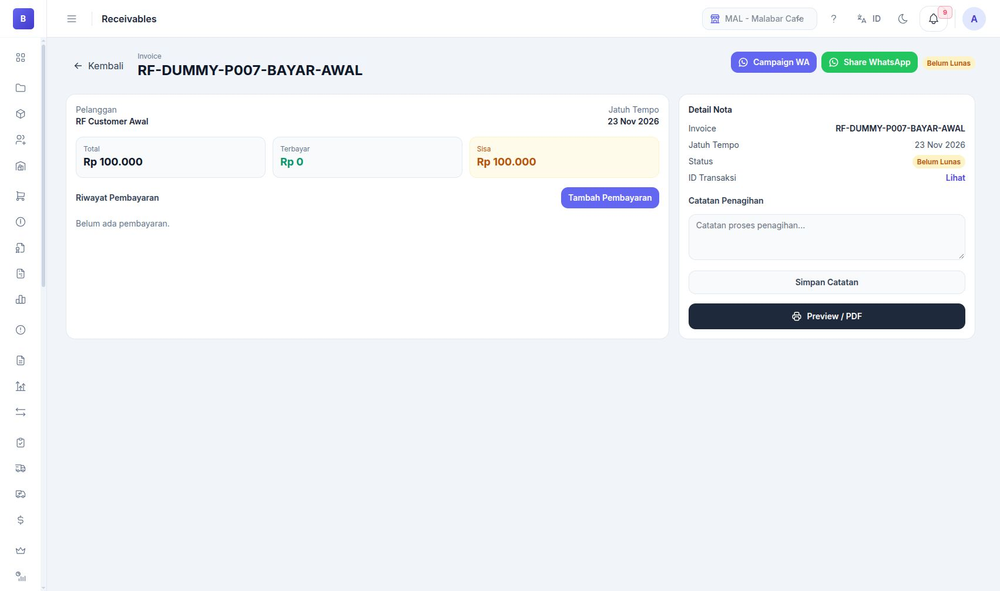  
  *Gambar 4.8. Daftar piutang dan sisa tagihan awal.*

* **Sesudah Refactoring:**
  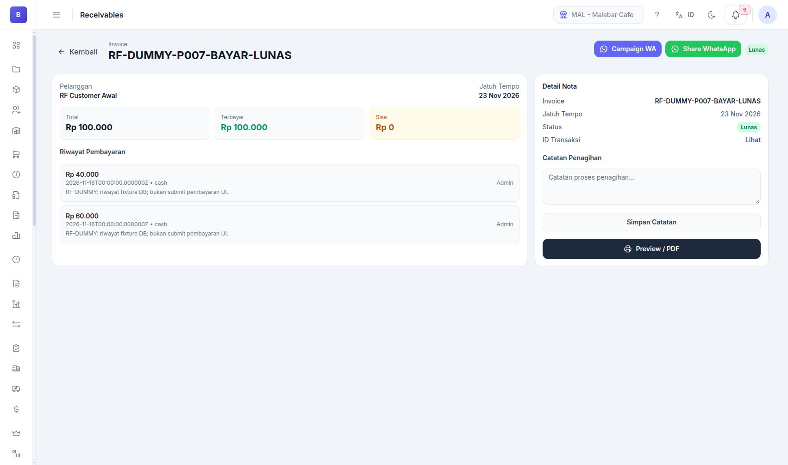  
  *Gambar 4.9. Status piutang lunas dan pencatatan riwayat pembayaran sesudah menggunakan service.*

* **Keterangan Perbandingan:** Pelunasan sebagian (parsial) dan pelunasan tepat sisa berhasil memperbarui sisa tagihan, mengubah status transaksi menjadi `paid`, dan mencatat riwayat pembayaran tanpa selisih.

---

### 4.6.5 RF-008: Pencatatan Pembayaran Hutang Supplier
Pada target ini, transaksi pelunasan hutang supplier dipindahkan dari controller ke `PayablePaymentRecorder`.

* **Sebelum Refactoring:**
  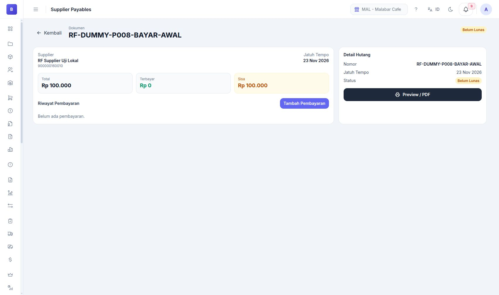  
  *Gambar 4.10. Daftar hutang supplier dan sisa tagihan awal.*

* **Sesudah Refactoring:**
  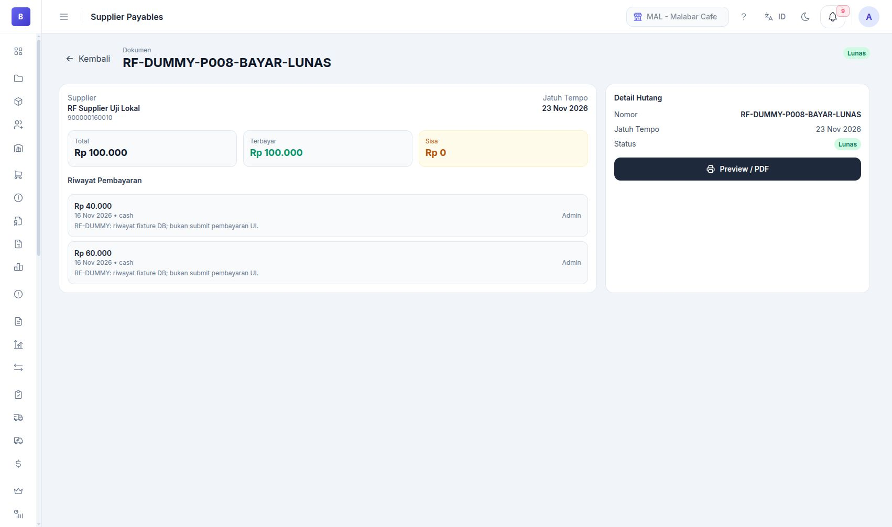  
  *Gambar 4.11. Status hutang supplier lunas sesudah diproses melalui service pembayaran.*

* **Keterangan Perbandingan:** Pemilihan rekening bank outlet, pengurangan saldo hutang, dan mutasi kas keluar berjalan normal.

---

### 4.6.6 RF-011: Laporan Aging Piutang dan Hutang
Pada target ini, kalkulasi interval umur tagihan (0–30, 31–60, 61–90, >90 hari) diekstrak ke kelas utilitas murni `DebtAgingBucket`.

* **Sebelum Refactoring:**
  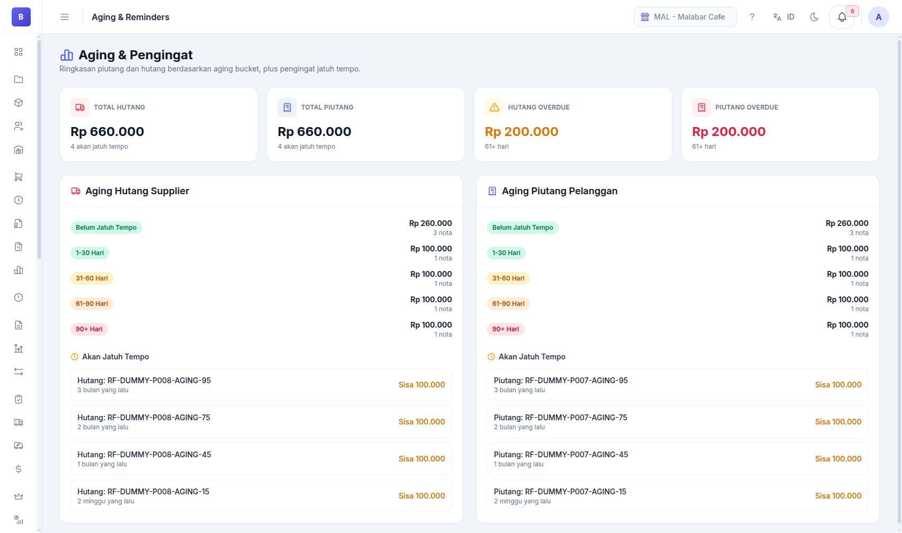  
  *Gambar 4.12. Kartu ringkasan interval aging piutang dan hutang.*

* **Sesudah Refactoring:**
    
  *Gambar 4.13. Tampilan tabel laporan aging sesudah perhitungan dipusatkan ke helper.*

* **Keterangan Perbandingan:** Pengelompokan tagihan ke dalam interval hari jatuh tempo menghasilkan data ringkasan dan tabel yang persis sama.

---

### 4.6.7 RF-015: Form Validasi Retur Penjualan
Pada target ini, array aturan validasi pada `StoreSalesReturnRequest` dan `UpdateSalesReturnRequest` disatukan ke `SalesReturnRules`.

* **Sebelum Refactoring:**
  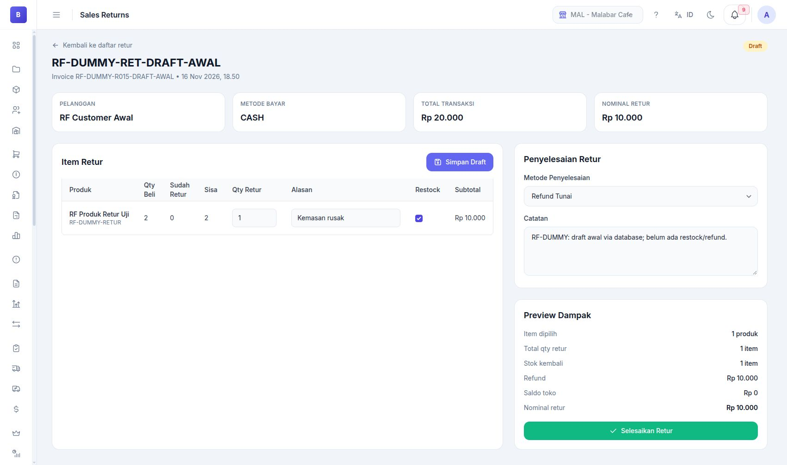  
  *Gambar 4.14. Draft form retur penjualan awal.*

* **Sesudah Refactoring:**
    
  *Gambar 4.15. Form retur penjualan sesudah penyatuan aturan validasi.*

* **Keterangan Perbandingan:** Validasi batas kuantitas retur, pemilihan alasan retur, dan penentuan pengembalian dana (*refund cash / store credit*) tetap konsisten.

---

### 4.6.8 RF-032: Format Mata Uang Rupiah pada Struk dan Kasir POS
Pada target ini, fungsi pemformat Rupiah dipusatkan ke utilitas `formatRupiah.js`.

* **Sebelum Refactoring:**
  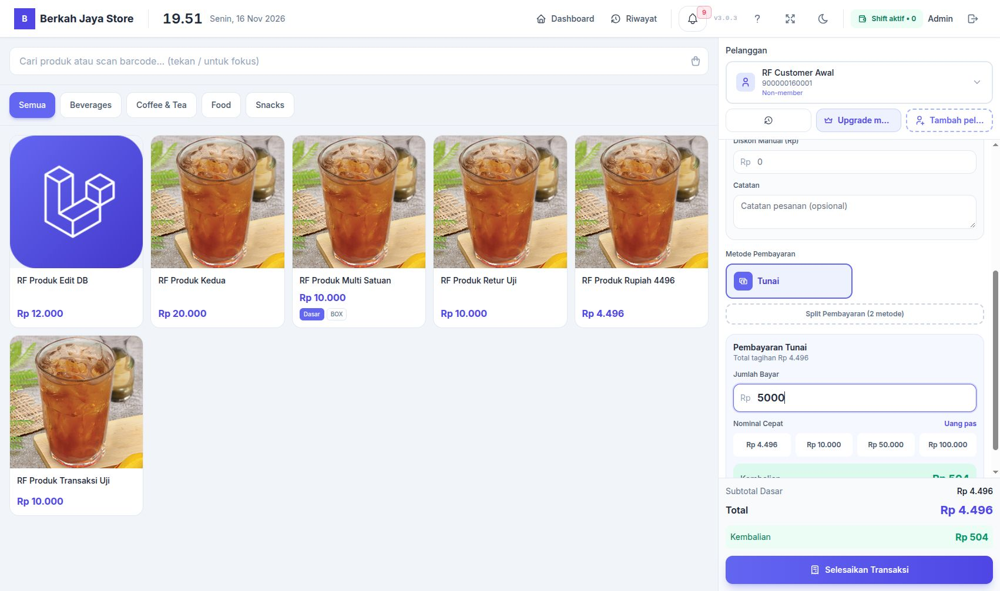  
  *Gambar 4.16. Tampilan transaksi kasir POS (total Rp4.496, tunai Rp5.000, kembalian Rp504).*

* **Sesudah Refactoring:**
  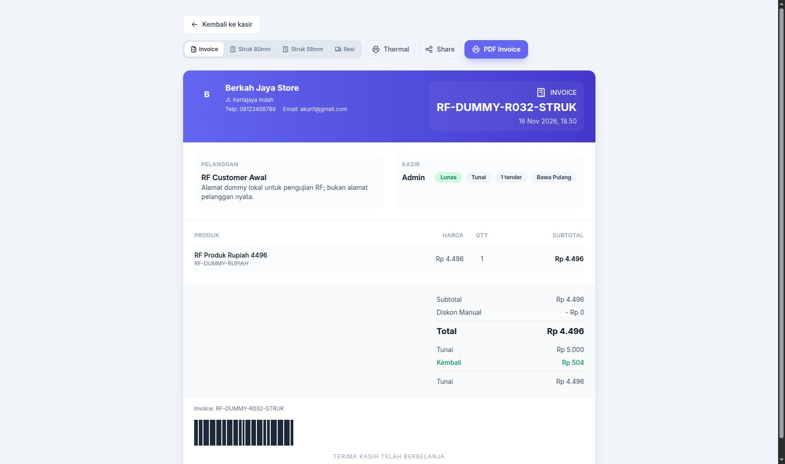  
  *Gambar 4.17. Tampilan struk invoice pembayaran sesudah menggunakan utilitas `formatRupiah.js`.*

    
  *Gambar 4.18. Tampilan kasir POS sesudah menggunakan utilitas `formatRupiah.js`.*

* **Keterangan Perbandingan:** Simbol mata uang `Rp`, pemisah ribuan titik, penanganan desimal, serta spasi non-breaking space (NBSP) menghasilkan tampilan nominal yang rapi dan konsisten di layar kasir maupun cetak struk.

---

## 4.7 Keterbatasan Validasi

1. **Lingkungan Pengujian SQLite:** Pengujian otomatis dijalankan menggunakan driver SQLite in-memory. Meskipun `lockForUpdate()` dipertahankan, perilaku konkurensi skala masif pada database produksi MySQL/MariaDB tetap memerlukan pengujian beban (*load testing*) terpisah.
2. **Keterbatasan Ekstensi Imagick:** Satu pengujian endpoint QR code meja makan (`V1DineInApiTest::test_dine_table_qr_returns_png`) dilewati (*skipped*) karena ekstensi PHP Imagick tidak terpasang pada lingkungan pengujian lokal.
3. **Frontend Stubbing:** Pengujian komponen React pada Node.js menggunakan stub komponen form; interaksi drag-and-drop atau animasi visual browser diverifikasi secara manual.

---

# 5. KESIMPULAN DAN REKOMENDASI

## 5.1 Kesimpulan

Berdasarkan seluruh rangkaian audit, implementasi, dan pengujian yang telah dilaksanakan pada proyek Point of Sales (POS):
1. **Keberhasilan Refactoring Paket Inti:** Seluruh 8 target refactoring yang direncanakan berhasil diimplementasikan dengan mematuhi prinsip *Clean Code* dan *Single Responsibility Principle*.
2. **Eliminasi Duplikasi Kode:** Duplikasi kode pada alur update produk, form produk Create/Edit, query wilayah, transaksi pembayaran piutang/hutang, penentuan bucket aging, validasi retur, dan formatter Rupiah berhasil dihilangkan tanpa mengubah perilaku eksternal sistem.
3. **Jaminan Kualitas (*Zero Regression*):** Pengujian menyeluruh menghasilkan **600 PHP tests lulus (0 failures)** dan 5 frontend tests lulus, membuktikan bahwa fungsionalitas dan integritas transaksi sistem tetap terjaga secara sempurna.

---

## 5.2 Keterbatasan Pengerjaan

1. Dari 91 temuan audit awal, kelompok memfokuskan pengerjaan pada 8 Paket Inti guna menjaga stabilitas sistem dan membatasi risiko pada transaksi inventaris yang sensitif.
2. Sisa 83 kandidat lainnya (60 opsional dan 23 ditunda) telah dipetakan sebagai *technical debt backlog* untuk iterasi pengembangan berikutnya.

---

## 5.3 Rekomendasi

1. **CI/CD Automation:** Mengaktifkan kembali GitHub Actions dengan runner yang mendukung PHP 8.4 dan Node.js 22 agar pengujian otomatis berjalan setiap kali ada *pull request*.
2. **Penyempurnaan Layanan WhatsApp:** Memisahkan konfigurasi service WhatsApp ke dalam file environment independen dengan penanganan timeout jaringan yang lebih adaptif.
3. **Penyelesaian Bertahap Backlog:** Melanjutkan refactoring untuk kelompok kandidat opsional (seperti standardisasi modal popup dan penomoran dokumen otomatis) secara bertahap menggunakan pendekatan characterization test yang sama.

---

# DAFTAR PUSTAKA

1. Fowler, M. (2018). *Refactoring: Improving the Design of Existing Code* (2nd ed.). Addison-Wesley Professional.
2. Martin, R. C. (2008). *Clean Code: A Handbook of Agile Software Craftsmanship*. Prentice Hall.
3. Putra, A. D. (2026). *Point of Sales Repository*. GitHub. https://github.com/aryadwiputra/point-of-sales
4. Kelompok 3 EPL. (2026). *Kelompok 3 EPL Refactoring Repository*. GitHub. https://github.com/ItsDannz/kelompok3-epl
5. Laravel LLC. (2026). *Laravel 13 Documentation*. https://laravel.com/docs
6. React Documentation Team. (2026). *React 19 Documentation*. https://react.dev
7. Inertia.js Core Team. (2026). *Inertia.js Documentation*. https://inertiajs.com

---

# LAMPIRAN

## Lampiran A. Source Code, Versi, dan Petunjuk Menjalankan

* **Branch:** `codex/audit-refactoring`
* **Commit Baseline:** `81a91b8fc0ef479be9e0c751c0d11370d89dd8a2`
* **Commit Implementasi:** `7c9ba504818ad24b7bbe906b0103ccb86d5846af`
* **Tautan Komparasi Diff:** https://github.com/ItsDannz/kelompok3-epl/compare/d0f42ea...7c9ba50

### Petunjuk Instalasi Mandiri:
```powershell
git clone https://github.com/ItsDannz/kelompok3-epl.git
cd kelompok3-epl
git checkout codex/audit-refactoring
Copy-Item .env.example .env
(Get-Content .env) -replace 'DB_CONNECTION=mysql', 'DB_CONNECTION=sqlite' | Set-Content .env
New-Item -ItemType File -Path "database\database.sqlite" -Force
composer install
$env:PUPPETEER_SKIP_DOWNLOAD="true"; npm install
php artisan key:generate
php artisan storage:link
php artisan migrate --seed
php artisan seed:demo --force
npm run build
php artisan serve
```

---

## Lampiran B. Bukti Pengujian Otomatis

```text
PHPUnit 12.5.31 by Sebastian Bergmann and contributors.

Runtime:       PHP 8.4.25
Configuration: D:\SEMESTER 5\EPL\TUGAS 1 EPL\point-of-sales\phpunit.xml

...............................................................  63 / 601 ( 10%)
............................................................... 126 / 601 ( 20%)
............................................................... 189 / 601 ( 31%)
............................................................... 252 / 601 ( 41%)
............................................................... 315 / 601 ( 52%)
............................................................... 378 / 601 ( 62%)
............................................................... 441 / 601 ( 73%)
............................................................... 504 / 601 ( 83%)
............................................................... 567 / 601 ( 94%)
................................S                               601 / 601 (100%)

Time: 00:32.418, Memory: 68.50 MB

OK, but some tests were skipped!
Tests: 601, Assertions: 2647, Skipped: 1.
```

---

## Lampiran C. Katalog Screenshot UI Tambahan

Seluruh berkas gambar resolusi tinggi tersimpan pada repositori lokal dan GitHub kelompok di:
* `pembagian-refactoring/audit-pos/SS_UI/sebelum/` (38 gambar baseline)
* `pembagian-refactoring/audit-pos/SS_UI/sesudah/` (11 gambar hasil refactoring)

---

## Lampiran D. Skenario Demo 15 Menit

| Alokasi Waktu | Pemateri | Materi yang Didemokan | Bukti Kode yang Ditampilkan |
|---|---|---|---|
| **Menit 0–5** | **Aji Zaenul Musthofa** | Pembukaan, arsitektur sistem POS, penjelasan **RF-001** (Satukan alur update produk), **RF-003** (Resolver wilayah pelanggan), dan **RF-011** (Penentuan aging bucket). | Tampilkan `ProductController.php`, `RegionPayloadResolver.php`, dan `DebtAgingBucket.php`. Jalankan test backend. |
| **Menit 5–10** | **Farras Abdurrazaq Ar-Rasyid** | Penjelasan **RF-007** & **RF-008** (Pencatatan pembayaran piutang dan hutang dengan locking), serta **RF-015** (Penyatuan rules validasi retur). | Tampilkan `ReceivablePaymentRecorder.php`, `PayablePaymentRecorder.php`, dan `SalesReturnRules.php`. Demo transaksi bayar hutang/piutang. |
| **Menit 10–15** | **Hazza Danta Hermandanu** | Penjelasan **RF-002** (Modularisasi komponen form produk Create/Edit) dan **RF-032** (Formatter Rupiah di struk dan kasir). Kesimpulan & sesi tanya jawab. | Buka browser, tunjukkan form Create produk dengan multi-satuan dan komposit, serta layar kasir POS. |

**Nama File Akhir yang Diekspor:** `Kelompok3_Laporan_Refactoring_dan_Testing.pdf`  
**Wakil Pengunggah PDF Kelompok:** Aji Zaenul Musthofa (5025241065)
